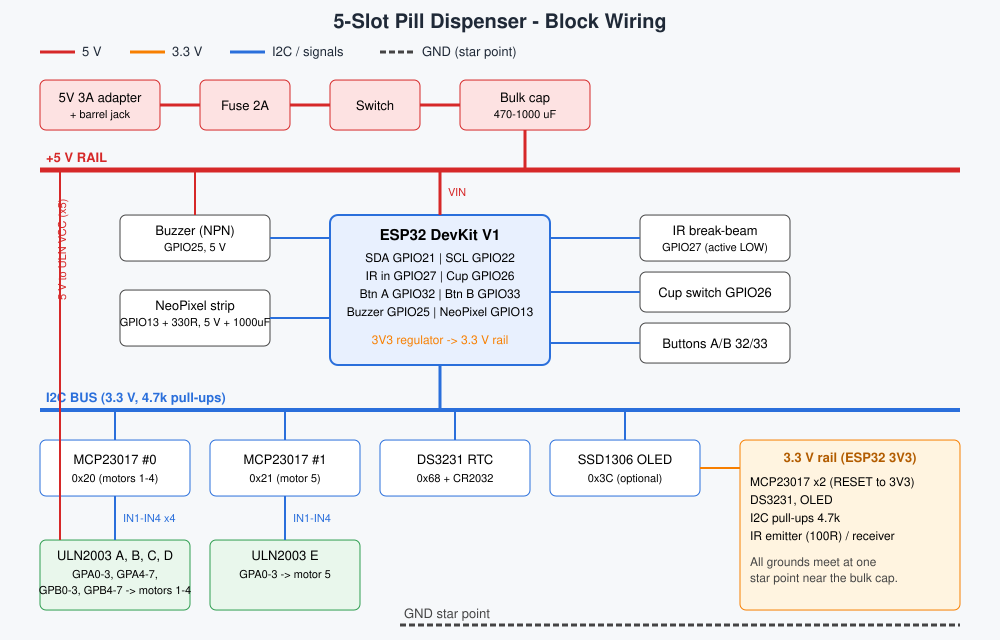

# Pill Dispenser

An open-source automatic pill dispenser: five hoppers, each holding one kind of pill, dispensing on a schedule into a single cup. Built from 3D-printed parts, a laser-cut enclosure, an ESP32 and five cheap geared steppers.

Every dose is confirmed by an infrared beam at the funnel, so the device knows whether a pill actually dropped, whether two dropped, or whether a hopper jammed, and tells you over push notification.



## Project status

This is an early prototype. Treat everything here as a starting point, not a finished design.

| Area | State |
|---|---|
| Mechanical (OpenSCAD) | Written, parametric. Has not been rendered or printed yet. |
| Firmware (ESP32) | Written, all modules in place. Has not been compiled or run on hardware yet. |
| Electronics (wiring, BOM) | Written. Diagram render-checked. Not built yet. |
| Enclosure (laser cut) | Not started. |

If you build one, please open an issue with what worked and what did not, especially pill dimensions and jam rates.

## Safety

This is a hobby project. It is not a medical device and has not been tested, certified or reviewed for dispensing medication to anyone.

- Do not rely on it as the only safeguard for medication that matters. Keep a manual backup and watch the missed-dose alerts.
- A mechanical dispenser can skip a dose, drop two, or jam. The firmware detects these cases but cannot fix them.
- Keep the hoppers sealed with desiccant. Humidity degrades pills and makes them stick.
- Lock or cover the hoppers if children or pets are around.

## How it works

Each of the five slots is an identical module: a hopper over a rotating disk with one pill-sized pocket. The disk turns clockwise, the pocket passes under the hopper and picks up one pill, a flexible wiper at the hopper exit knocks off any second pill, and half a turn later the pocket lines up with a hole in the base plate and the pill drops into a chute.

```
      +-----------+
      |  o  o  o  |   hopper (bulk pills, sealed lid + desiccant)
      | o  o  o o |
      +-----+-----+
   =====[pocket]==========   rotating disk, one pocket
   =================[hole]=  fixed base plate, one drop hole
                      |
                  chute -> shared funnel -> IR beam -> cup
```

All five chutes feed one funnel with a single IR break-beam at its throat. Pills are dispensed one at a time, so one sensor counts all of them. A microswitch under the cup confirms it is present before dispensing and detects when it is lifted, which counts as the dose being taken.

The firmware runs a closed loop per pill: turn the disk, wait for the beam to break, and if nothing drops, rock the disk back and forth and try again a few times before raising a jam alert.

## Repository layout

| Path | Contents |
|---|---|
| [`cad/`](cad/) | OpenSCAD source for one metering module. Edit [`cad/params.scad`](cad/params.scad) with your pill's dimensions and export STLs. See [`cad/README.md`](cad/README.md). |
| [`firmware/`](firmware/) | PlatformIO project for the ESP32: motor driving, drop detection, scheduler, persistence, web UI, notifications. See [`firmware/README.md`](firmware/README.md). |
| [`docs/wiring.md`](docs/wiring.md) | Full wiring guide: pin map, per-subsystem schematics, power budget, bring-up checklist. |
| [`docs/bom.md`](docs/bom.md) | Bill of materials with approximate prices. |
| [`docs/wiring.svg`](docs/wiring.svg) | Block-level wiring diagram. |

## Hardware overview

| Part | Role |
|---|---|
| ESP32 DevKit V1 | Controller. WiFi for network time, the web UI and notifications. |
| 5x 28BYJ-48 stepper + ULN2003 | One per slot. Geared, quiet, cheap, enough torque to push through a jam. |
| 2x MCP23017 I2C expanders | The five motors need 20 control lines. |
| IR break-beam pair | Counts pills at the funnel throat. |
| Microswitch under the cup | Cup present, cup lifted. |
| DS3231 RTC | Keeps time through power and WiFi outages. |
| Buzzer, NeoPixel, two buttons, optional OLED | Local alerts, "dispense now", "I took it". |
| 5 V 3 A supply | Only one motor is ever energized at a time. |

Rough cost: USD 60 to 110 if you already have an ESP32, passives, wire and filament; 150 to 250 from nothing. Details in [`docs/bom.md`](docs/bom.md).

## Getting started

### 1. Print one module and test it with candy

Measure one pill with calipers (length, width, thickness) and set the values in [`cad/params.scad`](cad/params.scad). Export and print the disk, base plate, hopper, lid and chute. PETG is recommended for the parts that touch pills.

```sh
cd cad
bash export.sh
```

Run the module by hand or with a single motor for a few hundred cycles. Count singles, doubles and misses. Adjust the pocket depth and the wiper until it is reliably one pill. This is where most of the work is, and nothing downstream matters until it is solid. Tic Tacs and M&Ms are good stand-ins for real pills.

### 2. Wire the electronics

Follow [`docs/wiring.md`](docs/wiring.md). The pin map there and the one in [`firmware/src/config.h`](firmware/src/config.h) are the same by construction. The bring-up checklist at the end of the wiring guide tells you what to expect from an I2C scan and how to test one motor and the beam sensor before connecting all five.

### 3. Flash the firmware

Requires [PlatformIO](https://platformio.org/).

```sh
cd firmware
cp include/secrets.h.example include/secrets.h
```

Edit `include/secrets.h` with your WiFi credentials, an unguessable [ntfy.sh](https://ntfy.sh) topic, and a username and password for the web UI (the build refuses to run without them). Set `TZ_STRING` in `src/config.h` to your POSIX timezone. Then:

```sh
pio run -t upload
pio device monitor
```

The serial monitor prints the device's IP. Open `http://<ip>/` to set pill counts and edit the schedule.

### 4. Replicate and enclose

Print four more modules, build the shared funnel and the enclosure, and run the whole thing with candy for a week before trusting it with anything that matters.

## Firmware features

- Schedule stored as JSON in LittleFS, editable from the web UI.
- Network time with the DS3231 as fallback. The RTC is resynced whenever NTP is reachable.
- Per-event "last dispensed" date is written to flash before the motor moves, so a reboot or power blip can never double-dose. A missed event still fires up to an hour late after an outage.
- Retry with agitation on a missed drop, double-drop detection, cup-present check before every pill.
- Pill counts per hopper, decremented by pills actually detected, with a low-stock warning.
- Push notifications via ntfy.sh for dose ready, dose not taken, jam, double drop, low pills, sensor problems, invalid clock, and every schedule or count change.
- Small web UI and JSON API on the local network, behind HTTP digest auth.

### Dose safeguards

The firmware enforces these on every path (schedule, web, button). Details and the tunable constants are in [`firmware/README.md`](firmware/README.md#safeguards).

- Each scheduled event dispenses at most once per day, recorded in flash before the motor moves.
- A hard cap on pills per hopper per day, counted from pills actually detected.
- A 30-minute lockout between manual dispenses of the same hopper. Button A must be held for a second.
- No dispensing without the cup, without the motor drivers, or when the beam sensor already reads blocked.
- Scheduled doses are suspended while the device has no valid time, and you get told.
- A hardware watchdog reboots the device if a motor move hangs.

## Known gaps

- Nothing has been compiled, rendered or run on hardware yet. Expect the first build and the first OpenSCAD render to need small fixes.
- Web UI auth is HTTP digest without TLS. Keep the device on your LAN; do not port-forward it.
- Notifications are dropped when WiFi is down; there is no queue.
- Dispensing blocks the main loop; the web UI is unresponsive for a few seconds during a dose.
- No enclosure design yet.
- No unit tests.

See the TODO list in [`firmware/README.md`](firmware/README.md) for the full set.

## Contributing

Issues and pull requests are welcome. See [`CONTRIBUTING.md`](CONTRIBUTING.md). Build reports from people who actually print and run this are the most useful thing you can contribute.

## License

[MIT](LICENSE). Copyright 2026 Jorge Guntanis.
